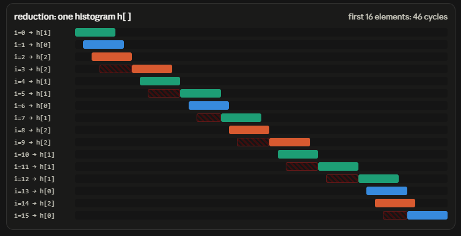
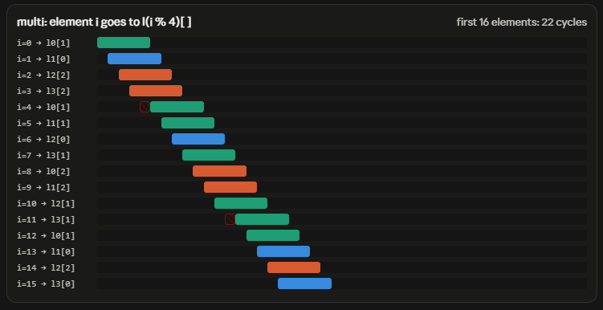

# OpenMP
Practice and benchmark OpenMP in C++

# 18 Oct 2026 (Histogram Building - Advanced)

**Problem statement**
- Same as 11 Oct: N = 1e8, B = 256, output hist[b] = count of value b
- New input: skewed distribution
    - 90% of values in bins {0, 1, 2}, 10% uniform over all 256 bins
    - Result: bins 0-2 get ~30M each, other bins ~40K each
```cpp
uniform_int_distribution<int> dist_all(0, B - 1);   // any bin
uniform_int_distribution<int> dist_hot(0, 2);       // bins 0, 1, 2 only
bernoulli_distribution is_hot(0.9);                 // true 90% of the time
data[i] = is_hot(rng) ? dist_hot(rng) : dist_all(rng);
```
- Baseline: histogram_reduction from last session

**Version 4: histogram_multi (K = 4 sub-histograms per thread)**
- Each thread keeps 4 private histograms l0..l3, element i goes to l(i % 4), merge at the end
```cpp
#pragma omp for schedule(static) nowait
for (size_t i = 0; i < N - N % 4; i += 4) {
    l0[data[i]]     += 1;
    l1[data[i + 1]] += 1;
    l2[data[i + 2]] += 1;
    l3[data[i + 3]] += 1;
}
```
- Speed: ~20ms best vs ~32ms reduction (~1.6x)
- Why it works: instruction-level parallelism (ILP) inside one core
    - A core does not finish one instruction before starting the next: pipelining + out-of-order execution keep many increments in flight
    - Result is guaranteed as if sequential, so the core must respect dependencies
    - `h[1] += 1` twice in a row: second load must wait for first store (store-to-load forwarding, ~6-8 cycles on Zen 3)
    - Skewed data = same bin hit back-to-back very often = core stalls on its own writes
    - l0[1] and l2[1] are different addresses: no dependency, increments overlap




- Same fix as last session at a different scale

| Scale | Collision on hist[0] | Symptom | Fix |
|---|---|---|---|
| Across threads | Two cores | Race + cache line ping-pong | One private hist per thread |
| Inside one core | Nearby iterations | Stall waiting for previous store | Several sub-hists per thread |

- Difference: across cores collisions are per cache line (64B), inside one core only the exact same address matters

**Version 5: sweep K = 4, 8, 16, 32**
- Generic version with K sub-histograms in one buffer: `local[k * B + data[i + k]] += 1`
- Expectation: gain stops once K covers latency x throughput (~4-8), more K only adds footprint and merge cost

| K | Time range (all runs) | Verdict |
|---|---|---|
| 1 (reduction) | ~32-43ms | baseline |
| 4 | ~20-33ms | best |
| 8 | ~22-30ms | tied with 4 (within noise) |
| 16 | ~27-33ms | mildly worse |
| 32 | ~70-76ms | ~3x worse, consistent |

- K = 32 slowdown is real, root cause not yet proven
    - Likely: L1 set conflicts. Sub-hists are exactly 1 KB apart, L1 set = address mod 4096, so hot bins of all sub-hists land in only 4 of 64 sets. Each set has 8 ways; K = 32 needs 8 per thread, 16 with both hyperthreads sharing L1 -> constant eviction even though L1 is mostly empty
    - Unlikely: 4K aliasing (would have hurt K = 8 too), code bloat, merge cost
    - Tests to confirm: pad stride (`BP = B + 16`), or 1 thread per core (`OMP_NUM_THREADS=2 OMP_PLACES=cores`)

**Version 6: histogram_multi_uint8**
- Same as multi K = 4, but data stored as `vector<uint8_t>` (values < 256)
- Speed: 17.2ms / 17.3ms (fastest and by far the most stable)
- Why faster:
    - data is 100 MB instead of 400 MB, far bigger than L3 (32 MB) either way: every line comes from RAM once
    - 64 elements per cache line instead of 16 -> 6.25M line fetches instead of 25M
    - Prefetcher hides the waiting, but the bytes still have to travel from RAM
    - Minimum time = bytes / bandwidth: int 400 MB / 48 GB/s = 8.3ms, uint8 = 2.1ms. Memory is no longer close to the counting time
- Why more stable:
    - The 64-core EPYC is shared with other VMs, all using the same memory channels
    - int versions swing 10-35% with neighbour traffic, uint8 has enough bandwidth headroom to not notice
- Same trick real GBDT libraries use (XGBoost / LightGBM store binned features as uint8)

**Overall Results (skewed input, 4 threads, best across all runs)**

| Version | Best time | Speedup vs reduction |
|---|---|---|
| reduction | ~32ms | 1.00x |
| multi K=4 | ~20ms | ~1.6x |
| multi K=8 | ~22ms | ~1.5x |
| multi K=16 | ~27ms | ~1.2x |
| multi K=32 | ~70ms | ~0.45x |
| multi uint8 (K=4) | ~17ms | ~1.8x |

*Shared 4-vCPU Codespace (AMD EPYC 7763, 2 cores x 2 threads). Run-to-run noise ~15-20%.*

**Storage of integer types**

| Type | Bytes | Range | Per 64B line | 1e8 elements |
|---|---|---|---|---|
| int8_t / uint8_t | 1 | -128..127 / 0..255 | 64 | 100 MB |
| int16_t / uint16_t | 2 | -32768..32767 / 0..65535 | 32 | 200 MB |
| int / int32_t / uint32_t | 4 | ~±2.1e9 / 0..~4.3e9 | 16 | 400 MB |
| int64_t / uint64_t | 8 | ~±9.2e18 / 0..~1.8e19 | 8 | 800 MB |

**Moral of the story**
- Writes to an address that something else must then read are the real cost: 
    - Accross threads: race, ping-pong cache invalidation  
    - Single thread: the same core's next instruction (stall)
- Same fix at every scale: replicate the counter, merge once at the end
- Replicate only enough to hide latency (K ~ 4-8), beyond that footprint and cache set conflicts take over
- Smaller data types cut memory traffic: a little faster, a lot more stable on shared hardware
- Personal notes:
    - seems like the runtime issue mainly caused by writing on an address that will be used later
    - but this time instead of 'cross-threads' cache ping-pong issue, we have the issue 'inside single thread' that is many write pending for the same address, and only 1 can be approved anytime
    - also seems like compressing data size and contiguous design is always beneficial

**Next session**
- Exercise 3: scheduling and load imbalance (Mandelbrot), `schedule(static/dynamic/guided)` and chunk size
- Optional: confirm K = 32 cause with padding or 1 thread per core

# 11 Oct 2026 (Histogram Building)

**Problem statement**
- Flat array `data` of N integers, each value in [0, B)
- Output array `hist` of size B, where hist[b] = number of elements equal to b
- Standard settings: N = 1e8, B = 256, uniform random data (`mt19937`, seed 42)
- Work per element is tiny (one increment), so the cost is all in how threads update the shared `hist`

**Version 0: histogram_naive**
- Serial loop: `hist[data[i]] += 1`
- Speed: ~47ms (one core owns `hist` the whole time, every increment is an L1 hit)

**Version 1: histogram_race**
- Add `#pragma omp parallel for` on top of the naive loop
- Result: wrong AND slower
    - Wrong: loses ~1.3-1.9M of 100M increments, different every run
    - Slow: ~450-570ms (~10x slower than serial)
- Why wrong: `hist[b] += 1` is load, add, store. Two threads load 42, both store 43, one increment lost
- Why slow: cache line ping-pong
    - 256 ints x 4 bytes = 1 KB = 16 cache lines (64 bytes = 16 ints per line)
    - Memory is cut into fixed 64-byte aligned blocks; touching hist[7] loads the whole block hist[0..15]
    - Only one core can hold a line in writable state (MESI). A write by core 0 invalidates core 1's copy of the whole line
    - With threads interleaving, the line moves between cores on nearly every increment (~40ns vs ~1ns L1 hit)
- Moral: threads writing to the same small shared array is slow even without locks, the hardware serializes it through cache coherence

**Version 2: histogram_local**
- Each thread builds its own private `local` histogram, then merges into `hist` once
```cpp
#pragma omp parallel
{
    vector<int> local(B, 0);                  // private per thread

    #pragma omp for schedule(static)
    for (size_t i = 0; i < N; i++)
        local[data[i]] += 1;                  // no sharing in hot loop

    #pragma omp critical
    for (int b = 0; b < B; b++)
        hist[b] += local[b];                  // only B adds per thread
}
```
- Speed: ~23ms best (~2.1x faster than serial), correct every run
- Why ~2x not 4x: only 2 physical cores (threads 3-4 are hyperthreads)
- Not memory-bound: 400 MB read in 23ms = ~17.5 GB/s, below the ~48 GB/s DRAM ceiling

**Version 3: histogram_reduction**
- Same idea in one line, OpenMP generates the private copies and the merge
```cpp
int* h = hist.data();
#pragma omp parallel for schedule(static) reduction(+ : h[:B])
for (size_t i = 0; i < N; i++)
    h[data[i]] += 1;
```
- `reduction(+ : h[:B])`: each thread gets a zeroed copy of h[0..B-1], copies are added (+) into h at the end
- `h[:B]` is an array section `[start : length]`, start defaults to 0
- Needs raw pointer: OpenMP reductions only understand scalars, C arrays and pointer sections, not `std::vector`
- Result is added into existing `hist`, so zero it before each call

**Results (best of 3, 4 threads)**

| Version   | Time    | Speedup | Correct |
|-----------|---------|---------|---------|
| naive     | ~47ms   | 1.00x   | yes     |
| race      | ~452ms  | ~0.10x  | no (~1.5% lost) |
| local     | ~23ms   | ~2.1x   | yes     |

**OpenMP constructs learned**
- `#pragma omp parallel { }`: fork a team, every thread runs the whole block. Variables declared inside are private, variables outside are shared. Brace must be on the next line
- `#pragma omp for schedule(static)`: split iterations into contiguous chunks (32 elements, 2 threads: T0 [0..15], T1 [16..31]). Implicit barrier at the end
- `#pragma omp critical`: only one thread at a time runs the whole following block. Without it the merge is still a race, just rare (dangerous, passes tests)
- Closing `}` of parallel: implicit barrier, then threads go back to the pool and the main thread continues alone
- `nowait`: removes the barrier after `omp for`. Safe only if the code after the loop uses nothing other threads wrote in that loop (safe in histogram_local, each thread only reads its own local next)

**Moral of the story**
- Never let threads write to shared data in the hot loop: give each thread a private copy, merge once at the end
- Locks are fine outside the hot loop (B adds vs N adds)
- Coherence keeps caches consistent but does not make `+=` atomic
- Personal notes:
    - vector add: no re-use, simple operation, independent in the loop, memory-bound
    - matrix multiply: a lot of reuse, need to be careful what stay in fast cache, but still write to different place
    - histogram build: got some reuse, cache is not an issue, but threads/core interaction and writing to the same memory address is the new challenge

**Other learning: cache vs cache line**
- Cache = small, fast storage close to the core (L1d is 32 KB per core on this CPU)
- Cache line = the 64-byte unit the cache stores and moves (L1d = 512 slots of 64 bytes)
    - "Data is in L1" means the cache line containing that data is in one of L1's slots
- The CPU only tracks whole cache lines, never a single int or address
    - Touching any byte loads the whole aligned 64-byte block around it (bytes before and after)
- Each core has its own private L1/L2, so the same line can have copies in several cores
    - Reading from shared copies is fine
- Writing requires exclusive ownership: before a core writes a line, every other copy is invalidated (MESI)
    - Keeps every core seeing the latest value (cache coherence)
- If multiple cores write to the same cache line, it bounces between them (ping-pong): each write forces a ~40ns transfer instead of a ~1ns L1 hit
    - Happens even if the cores write different variables on the same line (false sharing)
    
**Next session**
- Fill in reduction timing, add critical and atomic versions
- Advanced histogram: skewed input (90% in bin 0)
- Multiple sub-histograms per thread to break store-to-load dependency
- `uint8_t` data, OMP_NUM_THREADS = 1/2/4 sweep


# 04 Oct 2026 (Matrix Multiplication)

**FLOP**
- Floating point operation: one add/multiply on a double
- GFLOP = 1e9 operations

**Problem statement**
- Flat array A (MxN) and array B (NxP)
- Output array C (MxP)
- Number of operations = 2(M)(N)(P) = 12 GFLOP
- Standard settings: (2000, 3000, 1000)

**Version 0: matrix_multiply_naive**
- For each (m, p) coordinate in C, loop over n to find all A(m, n) and B(n, p) and sum product
- Speed: 15ms (very slow)
    - A only slides by 1 position in memory: $A[m*N + n]$
    - B slides by 1000 positions (P) in memory: $B[n*P + p]$
    - B will jump $8KB$ for each read (different cache line, different page)
- Change order of loop (m, p) to (p, m) reduce to 14.7ms (7ms if parallel) since accessing flat index of C is better and continuous (better but still very slow)

**Version 1: matrix_multiply_advanced**
- Effect: 0.7ms on parallel (10x faster than the previous)
- Example:
```
A = | 1 2 3 |        B = | row0 |   (each row of B is P numbers)
    | 4 5 6 |            | row1 |
                         | row2 |
```

- Previous version: fill C one number at a time
```
C[0][0] = 1·B[0][0] + 2·B[1][0] + 3·B[2][0]     ← walks down column 0 of B
C[0][1] = 1·B[0][1] + 2·B[1][1] + 3·B[2][1]     ← walks down column 1 of B
```

- This version: fill the whole row C at once
    - For each row of C, start with all 0s
    - For each row of B, collect scale factor $a$ from A. Then fill the whole row of C with (a x Row of B)
    - Idea change: 
        - Before: require column jump on B
        - After: follow the flat rows (no column jump) for B and C and enhance L1 usage
```
C row 0 = 1 × row0
        + 2 × row1
        + 3 × row2
```

**Version 2: matrix_multiply_ultimate**
- Effect: 0.5ms on parallel (1.2-1.4x faster than previous)
- Previous version: 
    - Update 1 row of C at a time 
    - Need to refetch row of B several times
- This version:
    - Update 4 rows of C at a time (by storing 4 scale factor from A)
    - Need to refetch row of B less frequently
    - 4 rows in C to be updated together fit in L1 cache (32KB)
- Moral of the story:
    - In hot loops, make data load as convenient (contiguous, predictable) as possible
    - Re-use data that is still fresh on cache
    - Design the loop to fit into L1/L2 cache where it is super fast

# 27 Sep 2026 (Vector Addition)

**CPU**
- AMD EPYC 7763 (Zen 3, "Milan"), 64-core server chip, shared with other VMs
- VM gets 4 vCPUs = 2 physical cores × 2 hyperthreads (SMT)
- Per core: 2 FP add units, AVX2 (4 doubles per instruction), ~24 billion double adds/s peak

**Cache and Memory**
- L1d: 32 KB per core (64 KB total, 2 instances)
- L1i: 32 KB per core (64 KB total, 2 instances)
- L2: 512 KB per core (1 MB total, 2 instances)
- L3: 32 MB, shared by both cores (and possibly other tenants on the same chiplet)
- RAM: 15 GiB total, ~11 GiB available

**Measured bandwidth (vector add, 32 B/element, best of 3)**
- L2-resident (1e4 elements, 240 KB): ~93 GB/s on 1 thread
- Mostly L3-resident (1e6, 24 MB): ~42 GB/s serial → ~68 GB/s with 4 threads
- DRAM (1e8, 2.4 GB): ~37 GB/s serial → ~48 GB/s with 4 threads (practical ceiling)

| Size | Data (a+b+c) | Where it lives  | Serial             | Parallel (nthread=4)          | Speedup |
|------|--------------|-----------------|--------------------|--------------------|---------|
| 1e4  | 240 KB       | L2 cache        | ~93 GB/s (3.5 µs)  | ~84 GB/s (3.8 µs)  | ~0.90x  |
| 1e6  | 24 MB        | mostly L3 cache | ~42 GB/s (0.76 ms) | ~68 GB/s (0.47 ms) | ~1.62x  |
| 1e8  | 2.4 GB       | DRAM            | ~37 GB/s (85 ms)   | ~48 GB/s (66 ms)   | ~1.28x  |

*Minimum of 3 rounds. Bandwidth assumes 32 bytes/element (read a, read b, write c + write-allocate of c). Run on a 4-vCPU GitHub Codespace (AMD EPYC 7763, 2 cores × 2 threads).*

**Notes**
- This exercise is cheap on computation, the difference is mostly on memory bandwidth
- Memory-bound loops gain little from threads once data is in DRAM (~1.3x)
- There are still speed-up since 1 core does not utilize all RAM bandwidth
- Small loops (< ~1e5 elements) lose to parallel overhead
- Results vary run to run due to shared hardware and vCPU scheduling